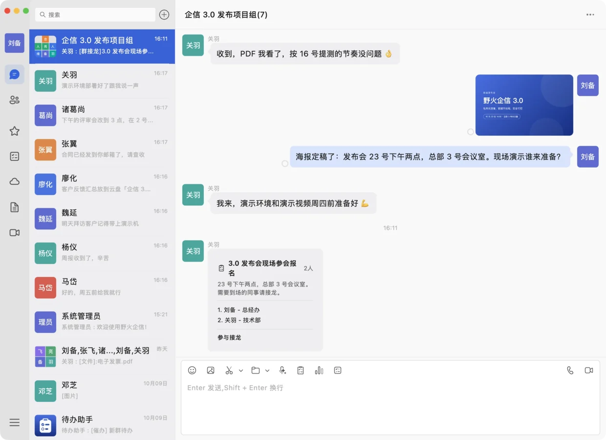
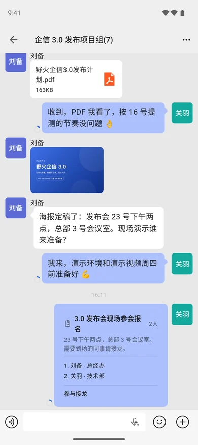
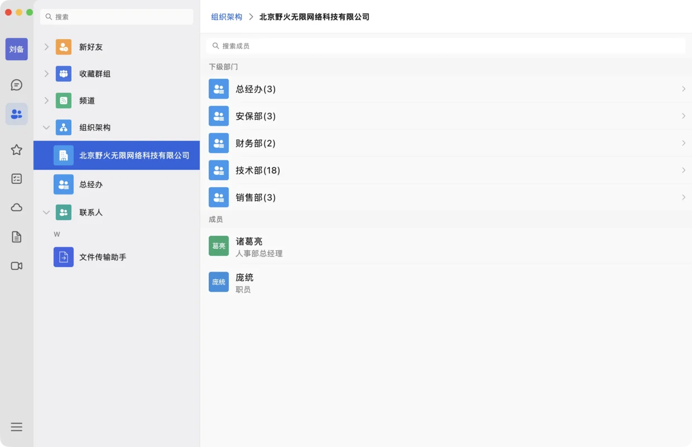
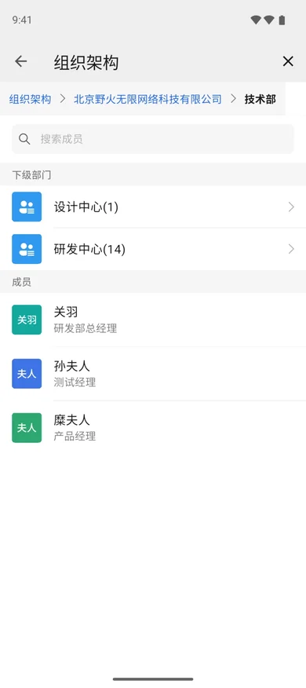
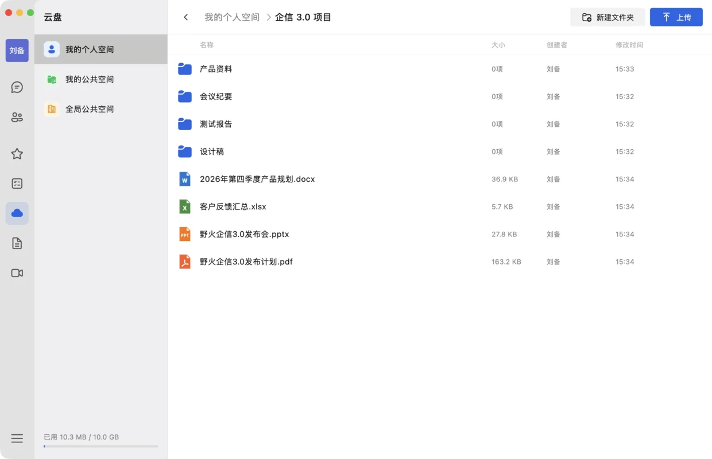
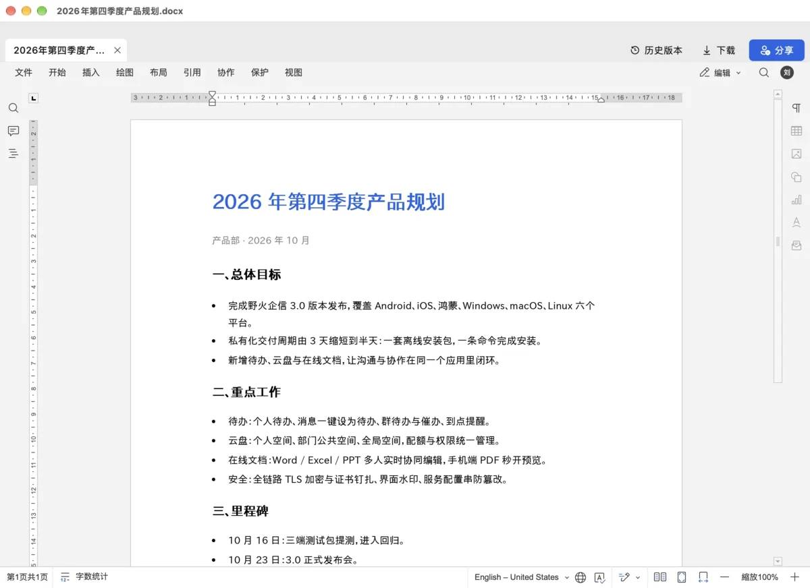
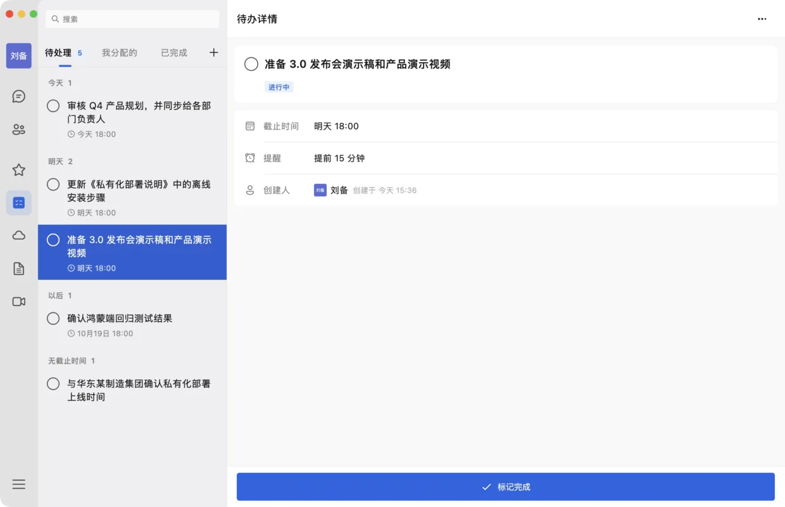

# 野火企信介绍

最近我们上线了一款新产品：[野火企信](https://qxim.cn)，一套可以私有化部署的企业即时通讯平台。这篇文章介绍一下它的由来、产品详情，以及它和野火IM的关系。

## 由来

野火IM是一套即时通讯的组件，包括IM服务、各平台的客户端SDK和客户端UI组件，客户拿去做二次开发，集成到自己的产品里，或者改造成自己需要的应用。这种形态灵活性很高，但前提是用的人得有开发能力。

一直以来都有这样的客户找到我们：一些传统企业、工厂、政企和保密单位，他们只是需要一套能在内网使用的沟通工具。这些单位要么没有软件开发团队，要么觉得为一个内部沟通工具投入一支开发队伍不值得。对他们来说，野火IM虽然功能齐全、安全可控，但组件的形态意味着从部署到二次开发再到集成上线，中间隔着一道开发的门槛，这个门槛他们迈不过去，也不想迈。

需求一直在，只是没有合适的产品去承接。正好最近我们给一家新能源电池工厂实施了一套内网沟通系统，从需求梳理、功能补齐到部署上线完整走了一遍。借着这次实施，我们把面向这类单位的功能打磨成了一套开箱即用的产品，这就是野火企信。

## 和野火IM的关系，会不会有冲突

先回答很多野火IM老客户可能关心的问题：**不会冲突**。

简单一句话：**野火IM是组件，野火企信是产品**。

野火IM面向有开发能力的团队，提供的是IM服务加SDK加UI组件，灵活性很大，可以任意改造、深度定制，集成进任何业务系统，做成任何想要的样子。代价是需要投入开发人力。

野火企信面向没有开发能力、或者不愿意为此投入开发的传统单位，是一套成型的产品。它不提供二次开发的能力，无法改动，只能直接使用。换来的是开箱即用：装好就能用，功能和界面都是定型的，像使用微信一样自然，又比微信多了组织通讯录、云盘、在线文档、待办、内网会议这些办公功能，满足传统单位直接使用的需要。

需要特别说明的是，我们做野火企信的定位就是标准产品，**不会做定制化项目，不会与客户做深度集成，也不承接基于野火企信的二次开发工作**。这些恰恰是野火IM客户（集成商、软件开发商）擅长和正在做的事情。野火企信服务的是那些不会成为野火IM客户的单位，两者面向的是完全不同的人群。如果您是开发者或集成商，想用野火IM为这类单位做定制化的内网沟通系统，我们一如既往欢迎，野火IM的路线不会有任何变化。

两者的底层技术是相通的，野火企信构建在野火IM多年积累之上，消息、音视频、多端同步这些核心能力都经过了大量生产环境的验证。选择哪个，取决于您有没有开发能力、需不需要定制：要改造就选野火IM，要直接用就选野火企信。

## 野火企信详情

野火企信的目标客户是传统的企业、工厂、政企和保密单位，有几个基本前提：

* 必须是可信的单位，我们会对采购方进行确认。
* 仅限于单位内部使用，账号由单位统一开通，不对外开放注册，不给单位以外的人员使用。

产品运行在单位自己的服务器上，聊天、组织通讯录、音视频会议、云盘与在线文档、待办，都装在单位内网，数据不出域。

### 即时沟通

单聊、群聊、文件、图片、语音，员工上手就会用。所有消息和文件都保存在单位机房，管理员可以依规查询和审计。群聊支持 @ 提醒、群公告、群管理与转让；支持引用回复、多选转发、合并转发；语音消息一键转文字；可以按文件、图片、链接、日期查找聊天记录；手机扫码登录电脑，多端消息实时同步。





### 组织通讯录

管理员在后台维护部门和成员，员工账号随通讯录统一开通，不对外开放注册。客户端里按部门逐级展开，职位一目了然，新同事第一天就能找到所有人。支持用 Excel 模板批量导入，几分钟搭好整个组织；部门官方群一键创建与修复；建群、转发时直接从组织架构里选人；外部单位成员单独标注，内外有别。





### 云盘与在线文档

个人空间、部门公共空间、全局公共空间三级管理，配额和权限由管理员统一设置。Word、Excel、PPT 在客户端里直接打开多人协同编辑，不用另装办公软件，并保留历史版本。云盘文件一键发到会话，收到的文件一键存进云盘；手机端 PDF 边下边看；管理后台可以查看空间用量和操作日志。





### 待办

任何一条消息都能一键设为待办，原文快照随待办保存；在群里新建待办分给多人，谁完成了、谁还没做一眼就能看到，未完成的可以一键催办；到点由待办助手准时提醒。个人待办按今天、明天、以后自动分组。




### 音视频会议

一对一通话、多人会议，音视频媒体服务和中转服务随系统一起部署，不依赖公网，内网、专网环境都能正常通话开会。支持立即发起会议、会议号加入、预约会议、会议密码；电脑端支持屏幕共享；手机端通话可缩成悬浮窗，iOS 支持系统来电界面。


### 更多功能

还有投票、接龙、收藏、聊天记录加密备份与恢复、深色模式、电脑端内置截图标注、网络诊断等功能，日常办公要用的都在一个应用里，不用再在聊天软件、网盘、文档工具之间来回切换。

### 客户端与接入

野火企信的客户端是统一的官方应用，覆盖 Android、iOS、鸿蒙（HarmonyOS NEXT 原生）、Windows、macOS 和 Linux 六个平台，也适配了统信 UOS、银河麒麟等国产系统和龙芯、申威等国产 CPU。因为是标准产品，所有单位用的是同一套应用，员工通过应用商店或者下载安装包安装即可，不需要为单位单独开发或打包。

客户端需要连接单位自己部署的服务器才能使用：已部署的单位，员工从单位内部的下载地址安装，扫描管理员提供的服务配置二维码就能连上单位的服务器。管理员在部署管理后台上传新版本安装包后，员工的客户端会自动提示更新。

### 私有化部署

全部服务装在一套离线安装包里，不需要联网，一条命令 ```sudo ./install.sh``` 完成安装，之后在浏览器里打开部署管理后台上传授权、点击启动即可，配置、升级、查看运行状态都在网页后台里完成。员工扫码即可接入。客户端只走 443 一个端口（HTTPS + WSS），音视频另需 3478/UDP。

一台 8GB 内存的 Linux 服务器即可运行全部服务，支持 x86_64 和 arm64 两种架构，已在 Ubuntu 24.04、银河麒麟 V10、OpenCloudOS 9 等环境实机验证。信创方面适配了银河麒麟、统信 UOS、OpenCloudOS 等国产操作系统，以及鲲鹏、飞腾、龙芯、申威等国产 CPU。

### 安全设计

私有化部署解决了「数据放在哪」的问题，野火企信还解决了「谁能连、谁能看、出了问题怎么查」：

* 全链路加密，证书钉扎。客户端内置单位 CA 证书作为信任锚，能识别并拒绝中间人。
* 账号由单位统一开通，没有自助注册，也不依赖短信验证码。
* 服务配置防篡改，客户端接入用的配置串经过加密校验，被改动过就无法使用。
* 界面水印，聊天和文档界面可叠加「账号 + 时间」水印，截图外传可追溯。
* 管理入口按网段限制，后台只对指定网段开放，内部接口不对外暴露。
* 敏感词拦截与操作审计，满足合规检查需要。
* 聊天记录可以加密备份到自己的电脑（AES-256 口令加密），换设备时再恢复。

## 试用

我们提供试用授权和离线安装包，可以在您自己的服务器上先跑起来，实际用过之后再决定是否采购。详情请访问[野火企信官网](https://qxim.cn)。
